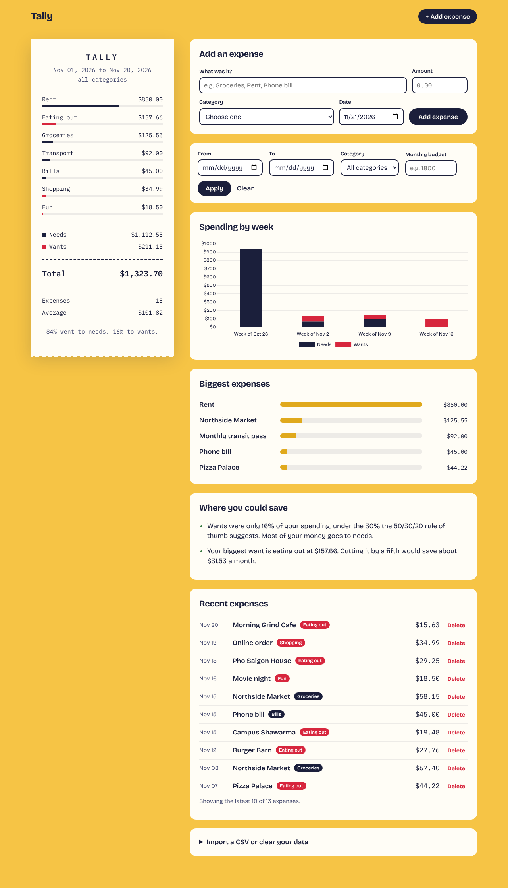
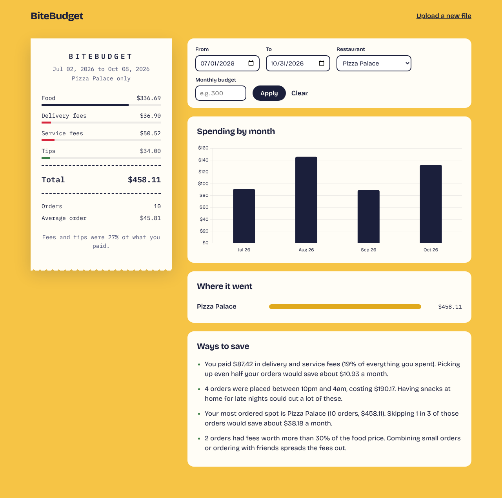
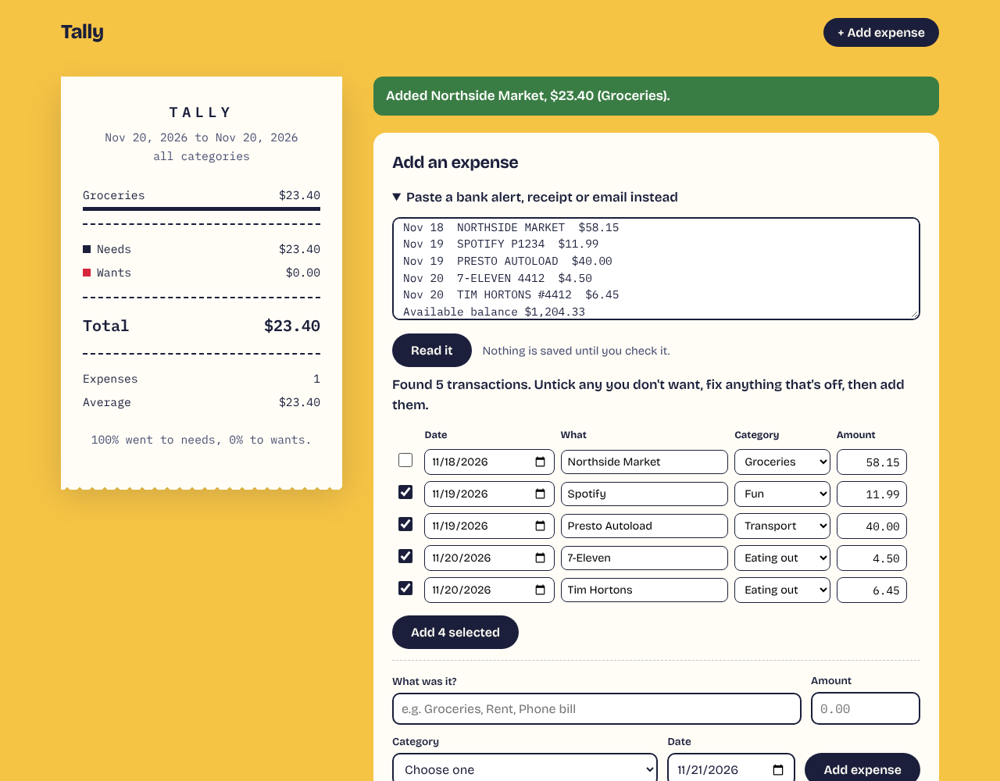
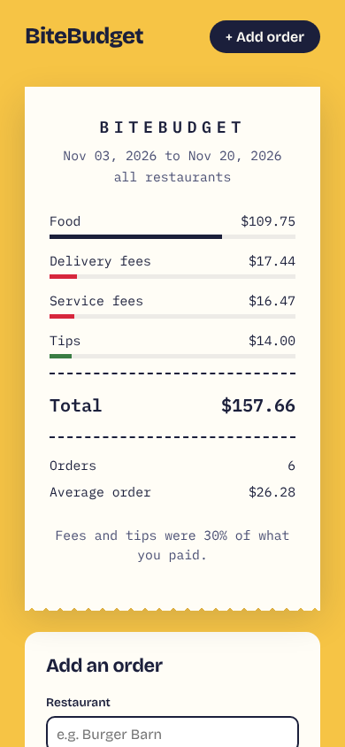

# Tally

A simple expense tracker that shows where your money actually goes, and where you could realistically save.

## Description

Every time you spend money you log it in Tally in a few seconds: what it was, how much, a category and the date. Or just **paste** the bank alert, receipt or order email and Tally fills it in for you. Your expenses are saved on your computer, and Tally turns them into a dashboard:

- an itemized **receipt** of your spending by category
- how much went to **needs** (rent, groceries, bills, transport, school, health) vs **wants** (eating out, shopping, fun, other)
- a chart of your spending over time, split into needs and wants
- your biggest expenses
- savings tips based on your own spending

You can filter by date range or category and set a monthly budget to see which months you went over. If you have a CSV from your bank you can import it, and there's a **demo with six months of sample data** to try the dashboard first.

## Purpose

This started as **BiteBudget**, an app for tracking food delivery spending, because I wanted to know what all my delivery orders added up to. After a few versions I realized two things. First, nobody actually has a CSV of their orders, so you need to be able to log things as you go. Second, a budgeting app that only looks at delivery is missing the big picture. If someone wants food brought to their house, that's their call. What matters is how it fits in with rent, groceries, bills and everything else.

So it became Tally, a general expense tracker for students or anyone who wants to see their whole month. It deliberately leaves needs alone and focuses its tips on wants, since that's where savings realistically come from.

## Features

- **Quick add form**: description, amount, category and date. If you type something you've logged before (like "Phone bill"), the category is picked for you.
- **Paste-text extractor**: paste a bank alert ("You spent $23.40 at NORTHSIDE MARKET on Nov 20"), an order confirmation email, a store receipt or a few lines copied from online banking. Tally finds the store, amount, date and category:
  - picks the real total on receipts, not the subtotal, tax, tip or change
  - understands dates like `2026-11-20`, `11/20/2026`, `Nov 20`, `20 Nov 2026` and "yesterday"
  - guesses the category from keywords (pharmacy → Health, Spotify → Fun) or from what you've logged before
  - one expense fills in the form; several lines show a list where you untick or fix rows before adding
  - plain rules (regular expressions), so there's no API key, it works offline and your text never leaves your computer
  - nothing is saved until you check it
- **10 categories** grouped into needs and wants
- **Saved expenses** in a local SQLite database (`data/tally.db`), so they're still there next time
- **Dashboard**: receipt by category, needs vs wants, a stacked spending chart (by week when you only have a month or two of data, by month after that), biggest expenses and savings tips
- **Savings tips** that leave needs alone: wants compared with the 50/30/20 rule of thumb, your biggest want and what cutting it by a fifth would save, small purchases under $10 that add up, and this month vs last month (it says "so far" if the month isn't over)
- **Filters** by date range and category
- **Monthly budget**: shows which months went over and by how much, with a budget line on the chart
- **Recent expenses** list with delete buttons, plus "delete all"
- **CSV import** (optional) with clear errors for missing columns, wrong file types and bad dates. Accepts a few date formats, `$` and commas in amounts, and CSVs saved from Excel.
- **Sample data demo** that doesn't touch your own data
- Works on phones, with an "Add expense" button at the top that jumps to the form
- Delivery orders saved by the old BiteBudget version are moved over automatically as "Eating out"

## Technologies

- **Python 3.10+**
- **FastAPI**: web server and routes
- **SQLite** (Python's built-in `sqlite3`): saves your expenses
- **Jinja2**: HTML templates
- **Chart.js 4.6.1**: charts (bundled in `app/static/vendor` so it works offline)
- **Bricolage Grotesque** and **IBM Plex Mono** fonts (bundled in `app/static/fonts`, SIL Open Font License)
- **pytest**: tests (48 tests)
- **Regular expressions** (Python's `re`): the paste-text extractor
- Plain HTML, CSS and a little JavaScript, no frontend framework

## AI Tools Used

- **Claude (Anthropic)**: planning the app, generating and refactoring code, writing tests, debugging, design, and drafting documentation

## Project Structure

```
bitebudget/                 # repo folder (the app was renamed from BiteBudget to Tally)
├── app/
│   ├── main.py             # FastAPI routes (add/delete expenses, import, dashboard, sample)
│   ├── db.py               # saving and loading expenses (SQLite)
│   ├── analysis.py         # categories, CSV parsing, totals, budget check, savings tips
│   ├── extractor.py        # reads expenses out of pasted text
│   ├── templates/          # pages plus the add-expense and import forms
│   └── static/             # CSS, fonts and bundled Chart.js
├── sample_data/
│   └── sample_expenses.csv # six months of made-up student expenses
├── scripts/
│   └── make_sample_data.py
├── data/                   # your saved expenses (created on first run, not in git)
├── tests/
│   ├── conftest.py         # gives each test an empty database
│   ├── test_app.py
│   └── test_extractor.py
├── docs/screenshots/
├── requirements.txt
├── requirements-dev.txt
└── PROMPT.md               # full log of how the app was built with AI
```

## Installation

You need Python 3.10 or newer.

```bash
git clone https://github.com/alenthomas206/bitebudget.git
cd bitebudget
python -m venv .venv
```

Activate the virtual environment:

- Windows: `.venv\Scripts\activate`
- Mac/Linux: `source .venv/bin/activate`

Then install the dependencies:

```bash
pip install -r requirements.txt
```

## Running the Application

```bash
uvicorn app.main:app --reload
```

Open **http://127.0.0.1:8000** in your browser and add your first expense, or click "See a demo with six months of sample data".

Your expenses are saved in `data/tally.db`. Delete that file to start fresh.

If you get `[WinError 10013] An attempt was made to access a socket...`, something else is already using port 8000. Use another port:

```bash
uvicorn app.main:app --reload --port 8080
```

Then open http://127.0.0.1:8080.

### CSV import format (optional)

Required columns: `date, description, amount`
Optional column: `category` (one of Rent, Groceries, Bills, Transport, School, Health, Eating out, Shopping, Fun, Other; anything else becomes Other)

```
date,description,category,amount
2026-11-01,Rent,Rent,850
2026-11-08,Northside Market,Groceries,67.40
```

### Running the tests

```bash
pip install -r requirements-dev.txt
python -m pytest
```

## How AI Was Used

Almost all of the code was generated by AI from natural-language prompts, then run, tested and fixed in steps. The app went through eight versions (see the commit history), and the biggest changes came from me trying it and deciding it wasn't right yet:

1. **V1**: upload a delivery order CSV, see totals
2. **V2**: better design and charts
3. **V3**: filters, budget and savings tips
4. **V4**: tests, then fixes for every bug the tests found
5. **V5**: full UI redesign after I ran it myself and thought it looked too simple
6. **V6**: log orders by hand and save them, because nobody has a CSV of their orders
7. **V7**: renamed to **Tally** and turned into a general expense tracker, because budgeting is about all your spending, not just delivery
8. **V8**: a paste-text extractor, so you can paste a bank alert or receipt instead of typing

The full prompt log is in [PROMPT.md](PROMPT.md). Three prompts that shaped the app the most:

> **1.** "Write pytest tests for the parsing, the maths, the filters and the web pages, including edge cases like an empty file, a CSV with the wrong columns, other date formats and filters that match nothing. Then fix whatever fails."

5 of the 15 tests failed at first. The app looked finished, but it crashed on empty files, other date formats and bad columns. Fixing those is what V4 is about.

> **2.** "ok so this is v5 but now lets make it practical" ... "i mean who would carry a lot of csv for their data"

The AI first asked what "practical" meant and suggested options like reading real app exports. My answer changed the idea: instead of analyzing a file once, the app became a tracker where you log each entry and it's saved (V6).

> **3.** "see firstly a budgeting app is not just about delivery prices if people want it to their house they should pay it its a necessity this app should track all expence instead of making delivery the big picture"

This turned BiteBudget into Tally (V7): categories, needs vs wants, and tips that leave necessities like rent alone. The old delivery orders were moved over automatically so no data was lost.

## Screenshots

**Welcome page with the add-expense form**


**My dashboard** after a few weeks of logging (receipt, weekly chart, tips, recent expenses)



**Six months of sample data with an $1,800 monthly budget**


**Filtered to one category** (Eating out)



**Pasting lines from online banking**: Tally finds 5 transactions, skips the balance line, and you untick or fix rows before adding



**Clear error when the amount isn't a number** (what you typed is kept)


**On a phone**



## Future Improvements

1. **Income and savings goals.** Track money coming in, not just going out, and set a goal like "save $500 by April" to see if you're on track.
2. **Budgets per category.** A separate limit for eating out or shopping instead of one monthly number.
3. **Recurring expenses.** Rent, phone and subscriptions could be added automatically each month instead of typed every time.
4. **Receipt photos.** The extractor reads pasted text. Reading a photo of a paper receipt would need OCR or an AI vision model.
5. **Accounts and hosting.** Right now it's one person's data on one computer. Logins and putting it online would let you log expenses from your phone anywhere.
6. **AI-written tips.** The tips are fixed rules. Sending the summary to an AI model (with the API key in an environment variable) could give more personal advice.

## Vibe Coding Reflection

> ✏️ **Draft. Alen: rewrite this in your own words before submitting.** The facts below are what actually happened during development. Add your own opinions and anything you noticed when you tried the app.

### 1. What did AI do particularly well?

It was really fast at the boring setup parts. The whole first version (FastAPI routes, templates, sample data generator) came from one prompt and worked the first time. It also wrote the 15 tests in one go, which I probably wouldn't have bothered doing that thoroughly myself. *[Add your own example]*

### 2. What did AI do poorly?

- In V2 it loaded Chart.js from a CDN link and the charts came out completely blank when the browser couldn't reach the internet. It had to be changed to a local copy of Chart.js.
- In V3 it typed the date filters as `date` in FastAPI, but an empty date box sends an empty string, so pressing "Apply" without picking dates gave a 422 error.
- The original code assumed every file would be perfect. An empty file or a file with different columns just crashed the app (5 tests failed).

### 3. How did you verify AI-generated code?

- Ran the app after every version and clicked through it with the sample data
- Took screenshots to check the charts and layout actually rendered
- Wrote pytest tests, including edge cases, and only moved on once they all passed
- Checked a few numbers by hand (for example, the small test CSV: 25 + 15.50 + 39.50 = $80.00)

*[Add anything you tested yourself]*

### 4. How did your prompts evolve?

Early prompts were broad, like "build an app that analyzes my delivery spending". Later prompts got much more specific: they named the exact bug (empty date fields cause a 422), listed the edge cases to test, and said exactly how something should look (months over budget in red with a dashed budget line). Specific prompts got the right result the first time; vague ones needed more back and forth.

*[Add your own take: the biggest changes came from my own short prompts ("make it practical", "who would carry a lot of csv", "a budgeting app is not just about delivery"). They weren't technical at all, but they changed what the app is for.]*

### 5. What did you learn?

*[Your own words. Ideas: how FastAPI handles query parameters, why testing edge cases matters, how Jinja templates work, or that AI code "working" on the happy path doesn't mean it's finished.]*

### 6. Would you trust AI to build the entire application without human supervision?

*[Your opinion.]* Things to consider: the app looked finished after V3 but still crashed on empty files and on an empty form field. Those only got caught because tests and manual checks were asked for. Without someone checking, those bugs would have gone straight to users.
