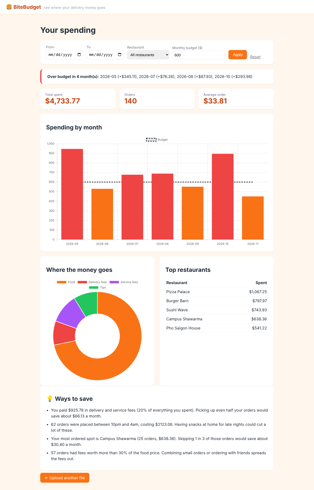
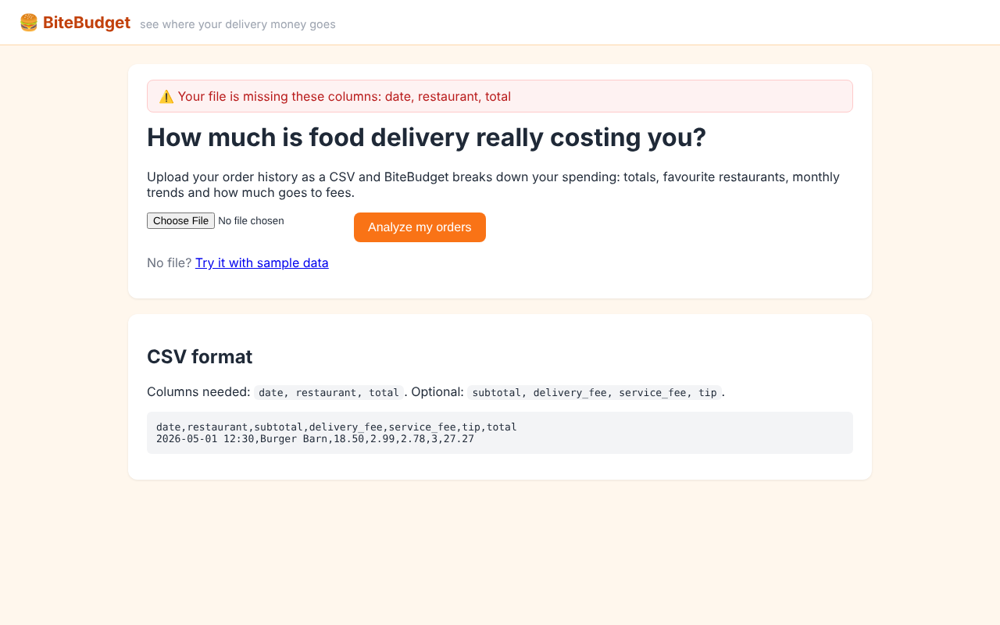

# BiteBudget 🍔

A small web app that shows you how much you're actually spending on food delivery.

## Description

You upload your food delivery order history as a CSV file (Uber Eats, DoorDash, etc.) and BiteBudget turns it into a spending dashboard:

- total spent, number of orders and average order
- a monthly spending chart
- how much of your money went to food vs delivery fees, service fees and tips
- your top 5 restaurants
- savings tips based on your own orders

You can filter by date range or restaurant and set a monthly budget to see which months you went over.

If you don't have a file you can click **Try it with sample data**, which loads 140 made-up orders.

## Purpose

I order food a lot, like most students, and I never really knew what it added up to. The apps show you one order at a time, not the total. I had already wanted to build an Uber Eats spending analyzer as a side project, so this assignment was a good excuse to actually build it. It's meant for students or anyone who orders delivery often and wants to cut back.

## Features

- **CSV upload** with checks: missing columns, wrong file types and bad dates show a clear error instead of crashing
- **Dashboard** with stat tiles, a monthly bar chart and a fees doughnut chart
- **Filters** by date range and restaurant
- **Monthly budget**: months over budget turn red on the chart and are listed with how much you went over
- **Savings tips** worked out from your data (fees you'd skip by picking up, late night orders, your most ordered spot, small orders with high fees)
- **Sample data** so the app can be tried without a real export
- Accepts a few date formats (`2026-03-01 18:00`, `03/01/2026 6:00 PM`, ...) and CSVs saved from Excel
- Works on mobile screens

## Technologies

- **Python 3.10+**
- **FastAPI**: web server and routes
- **Jinja2**: HTML templates
- **Chart.js 4.6.1**: charts (bundled in `app/static/vendor` so it works offline)
- **pytest**: tests (15 tests)
- Plain HTML and CSS, no frontend framework

## AI Tools Used

- **Claude (Anthropic)**: planning the app, generating and refactoring code, writing tests, debugging, and drafting documentation

## Project Structure

```
bitebudget/
├── app/
│   ├── main.py            # FastAPI routes (upload, report, filters)
│   ├── analysis.py        # CSV parsing, stats, budget check, savings tips
│   ├── templates/         # base, home and results pages
│   └── static/            # CSS and bundled Chart.js
├── sample_data/
│   └── sample_orders.csv  # 140 fake orders
├── scripts/
│   └── make_sample_data.py
├── tests/
│   └── test_app.py
├── docs/screenshots/
├── requirements.txt
├── requirements-dev.txt
└── PROMPT.md              # full log of how the app was built with AI
```

## Installation

You need Python 3.10 or newer.

```bash
git clone https://github.com/alenthomas206/bitebudget.git
cd bitebudget
python -m venv .venv
```

Activate the virtual environment:

- Windows: `.venv\Scripts\activate`
- Mac/Linux: `source .venv/bin/activate`

Then install the dependencies:

```bash
pip install -r requirements.txt
```

## Running the Application

```bash
uvicorn app.main:app --reload
```

Open **http://127.0.0.1:8000** in your browser. Upload a CSV or click "Try it with sample data".

### CSV format

Required columns: `date, restaurant, total`
Optional columns: `subtotal, delivery_fee, service_fee, tip`

```
date,restaurant,subtotal,delivery_fee,service_fee,tip,total
2026-05-01 12:30,Burger Barn,18.50,2.99,2.78,3,27.27
```

### Running the tests

```bash
pip install -r requirements-dev.txt
python -m pytest
```

## How AI Was Used

Almost all of the code was generated by AI from natural-language prompts, then run, tested and fixed in steps. The app was built in four versions (see the commit history):

1. **V1**: basic upload and totals
2. **V2**: better design and charts
3. **V3**: filters, budget and savings tips
4. **V4**: tests, then fixes for every bug the tests found

The full prompt log is in [PROMPT.md](PROMPT.md). Three prompts that shaped the app the most:

> **1.** "Build a FastAPI web app where I upload my food delivery order history as a CSV and it shows total spent, number of orders, average order and my top 5 restaurants. Include sample data so it can be tried without a real file."

This gave the base app (V1) and the sample data generator.

> **2.** "Add filters for date range and restaurant, a monthly budget that shows which months I went over, and savings tips based on my own orders like fees, late night orders and my most ordered restaurant."

This turned it from a simple stats page into something useful (V3). It also introduced a bug: leaving the date boxes empty gave a 422 error.

> **3.** "Write pytest tests for the parsing, the maths, the filters and the web pages, including edge cases like an empty file, a CSV with the wrong columns, other date formats and filters that match nothing. Then fix whatever fails."

5 of the 15 tests failed at first, and fixing them is what V4 is about.

## Screenshots

**Home page**


**Dashboard with a $600 monthly budget** (red months are over budget)



**Filtered to one restaurant and date range**


**Friendly error when the CSV has the wrong columns**



## Future Improvements

1. **Read real Uber Eats / DoorDash exports directly.** Right now the CSV needs my column names, so a real export has to be renamed first. Auto-detecting each app's format would make it much easier to use.
2. **Save reports.** Uploads are only kept in memory, so they're gone when the server restarts. A small SQLite database would fix that and allow comparing months over time.
3. **AI-written tips.** The savings tips are fixed rules. Sending the summary to an AI model (with the API key in an environment variable) could give more personal advice.
4. **Export.** Download the report as a PDF or share a link.
5. **Category tags.** Group restaurants into fast food, coffee, etc. to see which type of food costs the most.

## Vibe Coding Reflection

> ✏️ **Draft. Alen: rewrite this in your own words before submitting.** The facts below are what actually happened during development. Add your own opinions and anything you noticed when you tried the app.

### 1. What did AI do particularly well?

It was really fast at the boring setup parts. The whole first version (FastAPI routes, templates, sample data generator) came from one prompt and worked the first time. It also wrote the 15 tests in one go, which I probably wouldn't have bothered doing that thoroughly myself. *[Add your own example]*

### 2. What did AI do poorly?

- In V2 it loaded Chart.js from a CDN link and the charts came out completely blank when the browser couldn't reach the internet. It had to be changed to a local copy of Chart.js.
- In V3 it typed the date filters as `date` in FastAPI, but an empty date box sends an empty string, so pressing "Apply" without picking dates gave a 422 error.
- The original code assumed every file would be perfect. An empty file or a file with different columns just crashed the app (5 tests failed).

### 3. How did you verify AI-generated code?

- Ran the app after every version and clicked through it with the sample data
- Took screenshots to check the charts and layout actually rendered
- Wrote pytest tests, including edge cases, and only moved on once they all passed
- Checked a few numbers by hand (for example, the small test CSV: 25 + 15.50 + 39.50 = $80.00)

*[Add anything you tested yourself]*

### 4. How did your prompts evolve?

Early prompts were broad, like "build an app that analyzes my delivery spending". Later prompts got much more specific: they named the exact bug (empty date fields cause a 422), listed the edge cases to test, and said exactly how something should look (months over budget in red with a dashed budget line). Specific prompts got the right result the first time; vague ones needed more back and forth.

### 5. What did you learn?

*[Your own words. Ideas: how FastAPI handles query parameters, why testing edge cases matters, how Jinja templates work, or that AI code "working" on the happy path doesn't mean it's finished.]*

### 6. Would you trust AI to build the entire application without human supervision?

*[Your opinion.]* Things to consider: the app looked finished after V3 but still crashed on empty files and on an empty form field. Those only got caught because tests and manual checks were asked for. Without someone checking, those bugs would have gone straight to users.
